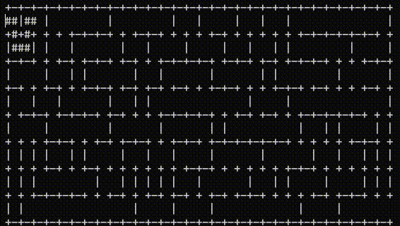

# Laberintos: BFS, DFS y Dijkstra

Programa en Java que resuelve laberintos con tres algoritmos de búsqueda
y muestra el recorrido animado en la terminal.




## Características

- Algoritmos: BFS, DFS y Dijkstra
- Animación del recorrido en la terminal
- Estadísticas: longitud del camino, vértices visitados y tiempo


## Cómo ejecutar

```bash
git clone https://github.com/CLLCZ/Laberintos-Fundamentos-de-Computacion3
cd Laberintos-Fundamentos-de-Computacion3\src\main\java
javac laberinto/Main.java
java laberinto/Main.java
```
En el directorio [Ejemplos Laberintos](Ejemplos%20Laberintos) se encuentran 3 laberintos de distintos casos, pruebalos.

Genera tus propios laberintos: https://www.delorie.com/game-room/mazes/genmaze.cgi


## Autores

- Sebastian Gastelum (gadfaeds): Menu principal, y animacion de despliegue de laberinto.
- <Compañero>: <qué hizo>